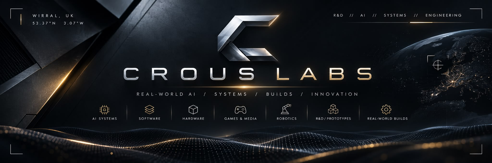

# Juandenè Crous

Self-taught builder from South Africa, based in the UK.

Building under **Crous Labs**: websites, small games, AI tools, and hardware ideas — learning in public and keeping the work honest.

## Play / view live

- [Crous WebCo](https://crouswebco-max.github.io/) — website work for local businesses
- [DOOMAZE](https://crouswebco-max.github.io/doomaze/) — early 2.5D maze shooter
- [Snake](https://crouswebco-max.github.io/snake-game/) — browser game with keyboard and swipe controls
- [A Game of Consequence](https://github.com/crouswebco-max/game-of-consequence) — projector-and-phone murder-mystery game
- [Money Builder](https://github.com/crouswebco-max/react-money-builder) — React investment calculator with charts and PDF reports

## Currently building

- A local AI command centre and business assistant
- A multiplayer party game you play with your phone
- Original co-op game concepts: Ghost Frequency, Salt Line, and The Hush

## Skills

`HTML` `CSS` `JavaScript` `React` `Vite` `Node.js` `Next.js` `TypeScript` `Tailwind CSS` `GitHub Pages`

## Find me

[X / Twitter: @LabsCrous](https://x.com/LabsCrous)
